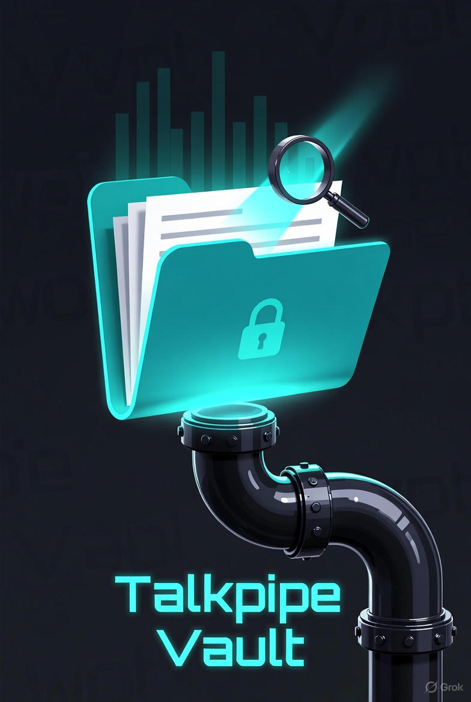
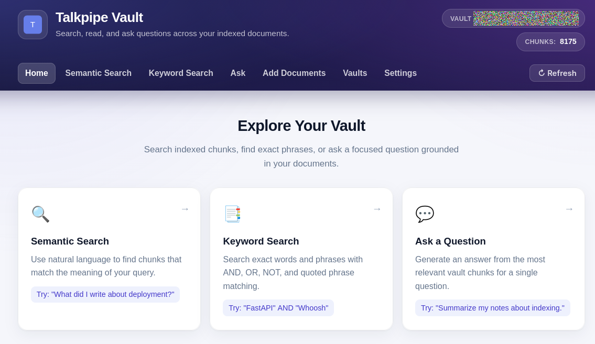
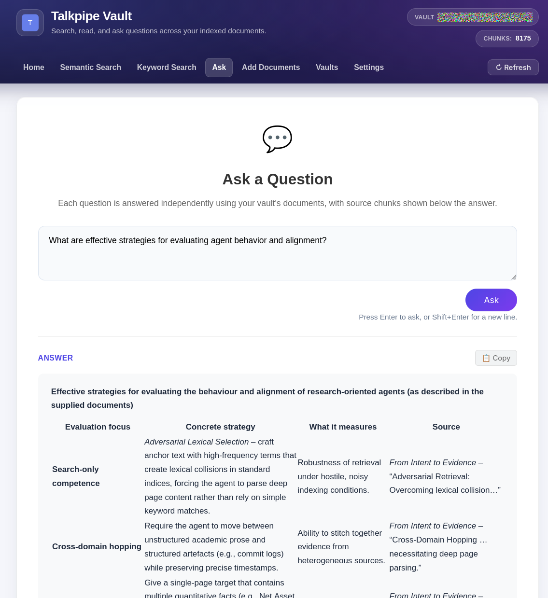

<p align="center">
  
</p>

<h1 align="center">TalkPipe Vault</h1>

<p align="center"><em>Point it at folders of documents and ask questions.<br>
Indexed on your machine, answered by the model you choose.</em></p>

<p align="center">
  <a href="https://www.python.org/downloads/"></a>
  <a href="https://opensource.org/licenses/Apache-2.0"></a>
  <a href="https://github.com/sandialabs/talkpipe-vault"></a>
</p>

<p align="center">

</p>
<p align="center">

</p>

## What is TalkPipe Vault?

TalkPipe Vault indexes folders of documents (notes, papers, reports, an
Obsidian vault, a project archive) into a local search index and lets you
explore them three ways, in a browser or in a terminal:

- **Semantic search**: find documents by meaning, not just words.
- **Keyword search**: precise full-text queries with boolean operators.
- **Ask**: single-turn Q&A with answers grounded in your documents.

Indexing happens on your machine: the built-in embedding model runs
in-process with no server or API key, and the indexes live next to your
documents. Answers come from the chat provider you choose: an
[Ollama](https://ollama.com/) server, OpenAI, or Anthropic (see
[LLM providers](#llm-providers)).

It is built on the [TalkPipe](https://github.com/sandialabs/talkpipe)
pipeline framework, and its indexing and search components are reusable in
your own pipelines; see the [Developer Guide](docs/DEVELOPER_GUIDE.md).

**Status:** alpha. This page describes the `master` branch, which runs
ahead of the PyPI release; the install commands below give the documented
behaviour. (The `@master` matters: the default branch, `stable`, is the
last release.)

## Run the web app

### Option 1: pip install

```bash
python -m venv .venv && source .venv/bin/activate   # Windows: .venv\Scripts\activate
pip install "git+https://github.com/sandialabs/talkpipe-vault.git@master"   # after the next release: pip install talkpipe-vault
vault-server ~/notes
```

Or install it as a standalone command with [uv](https://docs.astral.sh/uv/):
`uv tool install "talkpipe-vault @ git+https://github.com/sandialabs/talkpipe-vault.git@master"`
(after the next release: `uv tool install talkpipe-vault`).

Your browser opens at http://127.0.0.1:8002 with `~/notes` being indexed in
the background. Search and ask right away; the pages say how far indexing
has got. Started again later, `vault-server` reopens the folders you had
open. Without a path, add folders on the **Vaults & Documents** page.

The first index downloads the default embedding model from Hugging Face
(about 250 MB, cached afterward). Search and indexing need nothing more.
**Ask** needs a chat provider: pick it on the **Settings** page and enter
its server URL or API key there. Until one is reachable, Ask shows a
connection error that says how to fix it.

### Option 2: Container (Podman or Docker)

```bash
podman run --rm -p 8002:8002 \
  -v vault_data:/app/data \
  -v ~/Documents:/documents:ro,Z \
  -e TALKPIPE_OLLAMA_SERVER_URL=http://host.containers.internal:11434 \
  ghcr.io/sandialabs/talkpipe-vault:latest
```

Then open http://127.0.0.1:8002 (`127.0.0.1`, not `localhost`: rootless
podman publishes ports IPv4-only). `docker run` takes the same arguments.
The image is the last release, so until the next one it has no folder mode.

- `-v vault_data:/app/data` keeps settings, indexes kept in app data and the
  embedding-model cache across container recreation.
- `-v ~/Documents:/documents:ro,Z` is what the folder picker can see. Drop
  `:Z` on macOS and Windows; keep it on SELinux hosts such as Fedora.
- `-e TALKPIPE_OLLAMA_SERVER_URL=…` is optional and only for Ollama running on
  the host. For OpenAI or Anthropic, drop it and enter the key on the
  Settings page instead.

Compose, a customized image, and podman machine memory on macOS and Windows
are in the [Advanced Guide](docs/ADVANCED.md#containers).

## Folders

Choose the folders you want to ask about: on the **Vaults & Documents**
page, on the terminal interface's Vault tab, or on the command line.

```bash
vault-server ~/notes                      # or: vault-server --dir ~/notes --dir ~/papers
```

There is no vault to name or create. For each folder, and everything under
it:

- **Indexing runs in the background**, keywords first (searchable within
  minutes), then meaning. Every page says how far it has got, and keyword
  matches cover files not embedded yet.
- **Changes are picked up as they happen**: new, changed, renamed and
  deleted files.
- **Some files are skipped**: hidden files and folders (`.git`, `.obsidian`,
  …), editor temporary files, and formats no extractor reads.
- **Quitting loses nothing**: indexing resumes where it left off, and a
  second vault-server (`--port 8003`) or vault-tui on the same folder
  shares the index. Run `vault-server ~/papers` while one is up and the
  running instance adds the folder and opens in your browser.
- **Several folders** can be open together; every result names its folder.

The index lives in a hidden `.tpvault` folder inside each folder (git and
most backup tools skip it), or in the app's data directory when the folder
is read-only, on a network share or synced by a cloud client; see
[Folder mode](docs/ADVANCED.md#folder-mode). **Close** a folder to stop
searching and indexing it while it stays in the list, and **Open** it again
later; **Remove** drops it from the list and keeps its index unless you ask
for it to be deleted. Your documents are never touched.

To index a folder without starting an interface (a cron job, a build step),
run `vault-index ~/notes`; it processes what changed and exits
([Advanced Usage](docs/ADVANCED.md#vault-index)). To index, watch or search
folders from Python or ChatterLang, or to follow a folder's changes as a
stream of documents, see the [Developer Guide](docs/DEVELOPER_GUIDE.md).

### Named vaults

A named vault is an index kept in a separate folder of its own, for
documents you would rather not index in place. It lives under **Named
vaults (advanced)** on the Vaults & Documents page: pick the documents (a
folder or glob pattern), accept the suggested vault name, and one click
creates the vault and indexes into it. Opening a named vault closes the
folders you had open (the two do not mix); add a folder again to go back.
A named vault's keyword index is
built once with a button on the Keyword Search page and does not refresh
when you index more documents; rebuild it there when you do.

## The web interface

- **Vaults & Documents**: the folders being searched, with each one's
  progress, and the named-vault controls.
- **Semantic Search**: the ten closest chunks. **Let an agent select the
  results** hands the search to an agent that searches, reads, keeps what is
  relevant and stops when it judges it could answer your question; slower,
  and it needs a chat model that can call tools. Details and which models
  do well are in [Agent search](docs/ADVANCED.md#agent-search).
- **Keyword Search**: boolean and phrase queries. Matching is on exact word
  tokens (`apple` does not match `apples`); use semantic search for meaning.
- **Ask**: a single question, answered with citations you can open and copy.
  **Boost retrieval with keyword search** merges keyword matches into the
  context; **Use Agent** lets the agent gather the context instead, and
  **Extra Effort** gives it twice the iterations for questions that need
  one fact to find the next. The "Answered by" line says what ran.
- **Settings**: embedding and chat providers and models, the agent's
  limits, a **Configuration status** panel that tests the selection, and
  **Connections & credentials** for API keys and server URLs.

Every result and citation has an **Open** link that streams the original
document from the server, so it works the same from a container.

## The terminal interface (`vault-tui`)

The same features in a terminal (SSH, tmux, a headless machine), installed
with the package. It runs in-process and shares the web interface's
folders, settings and credentials.

```bash
vault-tui ~/notes         # search a folder of documents (add more with --dir)
vault-tui ~/my-vault      # open (or create) a named vault
vault-tui                 # reopen the last session's folders, else choose on the Vault tab
```

| Key | Tab | What you can do |
|-----|-----|-----------------|
| `F2` | Vault | Add and remove folders, open or create a named vault, index documents, edit the retrieval filter |
| `F3` | Search | Semantic search; `Enter` shows the chunk, `o` opens the source, `c` copies; **Use Agent** as in the browser |
| `F4` | Keywords | Full-text search |
| `F5` | Ask | Question answering with citations; keyword boost or **Use Agent** |
| `F6` | Settings | Configuration status, models, connections and credentials |
| `F1` / `Ctrl+R` / `Ctrl+Q` | | Help / reload / quit |

Ask needs a chat provider here too: choose it on the Settings tab and enter
its key or URL under **Connections & credentials**. More keys and behaviour
are in the [Advanced Guide](docs/ADVANCED.md#terminal-interface-notes).

## LLM providers

Two models are used: one for **embeddings** (indexing and semantic search)
and one for **chat** (Ask). Each can come from any provider TalkPipe
registers for that role:

| Provider | Embeddings | Chat | What it needs |
|----------|------------|------|---------------|
| `model2vec` | **default** (`minishlab/potion-retrieval-32M`) | no | Nothing: runs in-process; the model downloads once |
| `ollama` | yes | **default** (`mistral-small`) | A reachable Ollama server with the model pulled |
| `openai` | yes | yes | An API key; optionally a base URL for an OpenAI-compatible endpoint |
| `anthropic` | no | yes | An API key |
| `eliza` | no | plumbing check only | Nothing; its replies ignore your documents |

Your documents and indexes stay on your disk. Each question, together with
the snippets retrieved to answer it, goes to the chat provider you
configure; nothing else is sent anywhere, and with `model2vec` embeddings
and a local Ollama server nothing leaves your machine at all.

Pick the source and model for each role on the **Settings** page; the
choice persists and the **Configuration status** panel tests it. Enter keys
and URLs under **Connections & credentials** there, or set
`OPENAI_API_KEY`, `OPENAI_BASE_URL`, `ANTHROPIC_API_KEY` or
`TALKPIPE_OLLAMA_SERVER_URL` in the environment (a value saved in Settings
wins). Chat models can change at any time. Embeddings cannot: a folder
records the embedder it was indexed with and keeps using it for new files
and for searches, even after you pick a different one in Settings. Folders
indexed later get the new embedder, and a search across folders with
different embedders still works (each is queried with its own model and the
hits are fused). To move a folder to the new embedder, use its **Re-embed**
action. An index built before the embedder was recorded falls back to the
Settings embedder, so re-embed it if its results look wrong. The full
reference is in the [Advanced Guide](docs/ADVANCED.md#model-configuration).

## More documentation

- [Advanced Usage](docs/ADVANCED.md): the `vault-server` and `vault-tui`
  flag reference, confining paths on a shared machine, terminal interface
  notes, containers (compose, a customized image, macOS and Windows), model
  configuration and provider notes, agent search, retrieval filters, and
  where indexes live on disk.
- [Developer Guide](docs/DEVELOPER_GUIDE.md): every source and segment the
  vault registers (`indexFolder`, `watchFolders`, `folderChanges`,
  `vaultSearch`, `vaultChat`, …) with Python and ChatterLang examples, recipes
  for pipelines of your own, the Python helpers, and contributing.
- [Agent retrieval developer's guide](docs/AGENT_RETRIEVAL.md): the agent's
  tools, and using them in your own application.

## Requirements

- **Python** 3.11.4+ (pip install path)
- **A chat provider** for Ask: a local Ollama server, an OpenAI API key (or
  OpenAI-compatible endpoint), or an Anthropic API key. Indexing and search
  need no chat provider.

## Contributing

Contributions are welcome. Before submitting: `pytest` passes, and
`ruff check .`, `ruff format --check .`, and `mypy` are clean -- CI fails on
any finding from those three (`ruff check --fix . && ruff format .` fixes
most; `pre-commit install` runs them on every commit). See
[Contributing to the vault](docs/DEVELOPER_GUIDE.md#contributing-to-the-vault).

### Development environment

The default branch, `stable`, is release-only: it points at the latest
release, so what you see on the repository's front page describes that
release. Development happens on `master`, which is where merge requests go
and where unreleased changes and their documentation accumulate — check it
out first (`git checkout master` after cloning).

Local development uses [uv](https://docs.astral.sh/uv/) against the committed
`uv.lock`, so contributors share one reproducible set of versions:

```bash
uv sync --extra dev
uv run pytest
```

**CI does not use the lockfile.** It installs with pip (`pip install -e
'.[dev]'`) and resolves dependencies fresh, on purpose: that is what someone
running `pip install talkpipe-vault` gets, so the build breaks when *they*
would break. A dependency problem that only the lockfile hides is one we want
CI to see.

Two consequences worth remembering:

- `uv.lock` is a development convenience. It pins nothing for users and is not
  a security control — the version floors in `pyproject.toml` are what
  actually protect an install. Fix a vulnerable dependency by raising its
  floor, not by refreshing the lock.
- The lock must still stay honest. CI runs `uv lock --check`, which installs
  nothing and fails only when `uv.lock` and `pyproject.toml` have drifted
  apart. If you change dependencies, run `uv lock` and commit the result.

## Releasing

The release process — tag conventions, the manual application test that
must pass before tagging, and the publish steps — is in
[RELEASING.md](RELEASING.md).

## License

Apache License 2.0 — see [LICENSE](LICENSE).

## Authors

- **Travis Bauer** — *Initial development* — [Sandia National Laboratories](https://www.sandia.gov/)

## Acknowledgments

Built with [TalkPipe](https://github.com/sandialabs/talkpipe); vector storage
by [LanceDB](https://lancedb.com/); file monitoring with
[Watchdog](https://github.com/gorakhargosh/watchdog).
