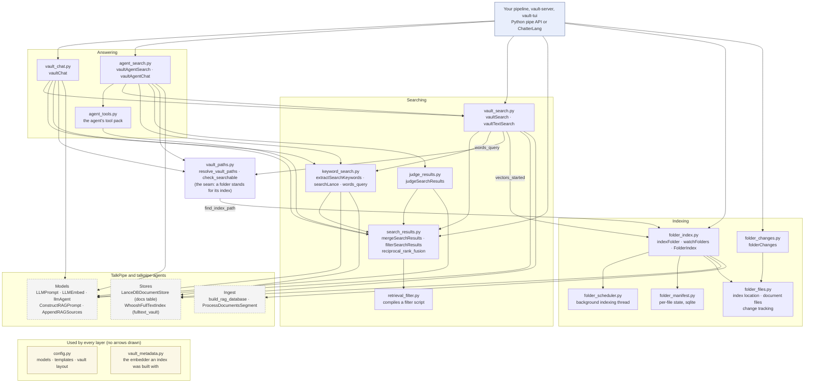

# TalkPipe Vault — Developer Guide

The vault's indexing, search and question-answering are TalkPipe sources
and segments. This guide is for a developer, or a coding agent, who wants to
use those components in pipelines of their own: a summariser that follows a
folder, a hybrid search over two collections, a redacting question answerer,
a nightly re-index from cron. Everything here runs without `vault-server`.

Operators and users of the interfaces want the [README](../README.md) and
[Advanced Usage](ADVANCED.md). Agent retrieval has a deep dive of its own,
the [agent retrieval developer's guide](AGENT_RETRIEVAL.md).

## Setup

```bash
pip install talkpipe-vault  # or the development branch: pip install "git+https://github.com/sandialabs/talkpipe-vault.git@master"
```

That installs TalkPipe and `chatterlang_script`. Every component below is
usable two ways:

- **Python**, TalkPipe's internal DSL: import the class or factory and join
  segments with `|`. A pipeline is a callable; `segment.as_function(...)`
  turns one segment into a plain function.
- **ChatterLang**, TalkPipe's external DSL: name the components in a script
  string, run it with `chatterlang_script --script '...'` or compile it with
  `talkpipe.compile(...)`. The vault registers its components as TalkPipe
  entry points, so a script finds them by name with no import.

Two conventions hold throughout:

- **Configuration comes from the environment, not the Settings page.**
  Pipelines read `TALKPIPE_*` variables and `~/.talkpipe.toml`
  ([Advanced Usage: Model configuration](ADVANCED.md#model-configuration)).
  Set `TALKPIPE_OLLAMA_SERVER_URL`, `OPENAI_API_KEY` or `ANTHROPIC_API_KEY`
  before running anything that needs a chat model. Leave `chat_source` and
  `chat_model` out to use the configured defaults.
- **A folder stands for its index.** Wherever a component takes
  `vault_path`, you may give the documents folder itself (its index lives in
  `<folder>/.tpvault`) or a named vault's path, or a list of either.

The examples use `/path/to/notes` and `/path/to/papers`; put your own
folders there. Every block was run before it landed here.

## The components

| Name | Kind | Takes | Emits |
|---|---|---|---|
| `indexFolder` | segment | folder paths | one status dict per folder, after indexing it |
| `watchFolders` | source | `paths=` | a status dict whenever a folder's progress changes; runs until stopped |
| `folderChanges` | source | `path=` | one dict per document file, then one per change; runs until stopped |
| `vaultSearch` | segment | a query string | a list of `SearchResult` (semantic) |
| `vaultTextSearch` | segment | a query string | one dict per keyword hit |
| `mergeSearchResults` | segment | an item holding result lists | the item with one merged list |
| `filterSearchResults` | segment | an item holding a result list | the item with the list filtered by a ChatterLang script |
| `extractSearchKeywords` | segment | a question | a Whoosh keyword query, written by a chat model |
| `judgeSearchResults` | segment | an item holding a result list and a question | the item with each result judged by a chat model: keep or ignore, and why |
| `vaultChat` | segment | a question | the answer string (or a dict with the background) |
| `vaultAgentSearch` | segment | a question | an `AgentSearchOutcome`: the chunks an agent kept |
| `vaultAgentChat` | segment | a question | an `AgentChatOutcome`: the answer built from them |
| `searchLance` | segment | a query string | hits from a LanceDB full-text index |
| `fileWatcher` | source | `path=` | raw filesystem events (experimental) |
| `listIntoVectorDB`, `watchIntoVectorDB`, `buildVectorDBFromPaths` | source, source, segment | a glob, a folder, file paths | indexed chunks in the experimental layout |

All folder components cover a folder's whole tree and skip hidden files and
folders (`.git`, `.tpvault`, …), editor temporary files, and files no
TalkPipe extractor reads.

### How the modules fit together

Every component above is a class or factory in one module under
`talkpipe_vault.pipelines`. The diagram shows those modules and the
hierarchy of calls between them: an arrow points from the module that calls
to the module it calls (its imports), so the layers read top-down from the
code that asks a question to the stores that hold the answer. Nothing calls
upward: a search module never imports an answering module, and the indexing
modules know nothing about search.



How to read it when building something of your own:

- **Import from the layer that does what you want.** An answer:
  `vault_chat` or `agent_search`. Hits: `vault_search`; keyword queries from
  a question: `keyword_search`; a chat model's verdict on each hit:
  `judge_results`; combining, fusing or filtering result lists
  from any source, even another search engine: `search_results`, which
  depends on nothing above the TalkPipe `SearchResult`. Building or
  following indexes: `folder_index` and `folder_changes`.
- **`vault_paths` is the seam between searching and indexing.** It maps a
  documents folder to its index and refuses what cannot be searched; every
  search component calls it before each query. The only other call from
  searching into indexing is `vault_search` asking `folder_index` whether an
  index has vectors yet. A component that takes `vault_path` therefore
  accepts a folder, a named vault, or a list of either, and keeps working
  when an index appears later.
- **`config.py` and `vault_metadata.py` are used by every layer** (model and
  template resolution, the vault layout, the embedder an index was built
  with); their arrows are left out to keep the picture readable.
- **The stores are TalkPipe's.** The LanceDB docs table and the Whoosh
  index are read and written only through `LanceDBDocumentStore` and
  `WhooshFullTextIndex`, and chat and embedding models only through
  `LLMPrompt` and `LLMEmbed`, so a provider or store you configure for
  TalkPipe is the one these components use.
- **The interfaces are callers like any other.** `vault-server` and
  `vault-tui` build their pipelines from the same modules your code would;
  nothing in `apps/` or `tui/` is needed to use a component.
- **`searching_and_prompting.py`** is the search modules' original import
  path and re-exports them; new code imports the module that holds what it
  needs.

### Shapes you will see

- **A semantic hit** is a talkpipe `SearchResult`: `hit.score` (similarity),
  `hit.doc_id` (the chunk id), `hit.document` (a dict with `content`,
  `source`, `title` and, from a folder, `folder`).
- **A keyword hit** is a dict: `{"doc_id", "score", "document": {"content",
  "path", "filename", "folder"}}`, with a Whoosh relevance score.
  `mergeSearchResults` normalises both shapes to `SearchResult` and, with
  `rename_fields="path:source,filename:title"`, makes keyword hits citable.
- **A folder status** is a dict: `root`, `name`, `phase` (`scanning`,
  `keywords`, `meaning`, `paused`, `ready`, `stopped`), `role` (`writer`,
  `reader`, `read-only`), `files_total`, `files_keyword`, `files_embedded`,
  `files_error`, `chunks`, `complete`, `finished`, `vector_error`, `error`.
- **A folder change** is a dict: `event` (`added`, `changed`, `deleted`),
  `path`, `relpath`, `folder`.
- **Chunk ids** are the same in both of an index's stores, so a keyword hit
  and a semantic hit for the same chunk dedupe by `doc_id`.

## Indexing

### Index a folder once: `indexFolder`

Brings each folder's index up to date: new and changed files are indexed,
deleted ones removed, keywords first and then vectors. Running it again
only processes what changed.

```python
from talkpipe_vault.pipelines.folder_index import index_folder

index = index_folder().as_function(single_in=False)
for status in index(["/path/to/notes", "/path/to/papers"]):
    print(status["root"], status["phase"], status["files_embedded"], "embedded")
```

```sh
chatterlang_script --script '
  INPUT FROM echo[data="/path/to/notes,/path/to/papers"]
  | indexFolder
  | print'
```

- `vectors=False` builds only the keyword index: fast, and no embedder is
  needed. Search such a folder with `vaultTextSearch` or
  `vaultSearch[keyword_fallback=True]`; a plain `vaultSearch` finds nothing
  in it until its vectors exist.
- `embedding_source` / `embedding_model` pick the embedder for a folder with
  no vectors yet. A folder already embedded keeps the model its vectors were
  made with.
- `field=` reads the folder path from a field of a dict item and `set_as=`
  puts the status on the item, so `indexFolder` fits in the middle of a
  pipeline.
- When another process is already indexing the folder, `indexFolder` leaves
  it alone and the status says `"role": "reader"`.
- The index is kept in `<folder>/.tpvault`, or in app data for a read-only,
  network or synced folder ([Advanced Usage: Folder mode](ADVANCED.md#folder-mode)).
- The `vault-index` command is this segment as a console script: it indexes
  the folders given and prints a line per folder
  ([Advanced Usage](ADVANCED.md#vault-index)).

### Keep folders indexed: `watchFolders`

Runs the background indexer the interfaces use: indexes each folder,
watches it for changes, rescans it periodically, and resumes where it left
off when restarted. It can run next to a `vault-server` on the same folders;
whichever starts first indexes, the other searches and takes over if it
exits. It emits a folder's status whenever its phase or counts change, and
runs until Ctrl+C or `max_events` statuses.

```python
from talkpipe.pipe.io import Print
from talkpipe_vault.pipelines.folder_index import watch_folders

pipeline = watch_folders(paths="/path/to/notes,/path/to/papers") | Print()
for _ in pipeline():  # runs until interrupted
    pass
```

```sh
chatterlang_script --script '
  INPUT FROM watchFolders[paths="/path/to/notes,/path/to/papers"]
  | print'
```

### Named vaults from code

A named vault is the same index kept in a directory of its own. Build one
with TalkPipe's `makevectordatabase` (the CLI behind the Vaults & Documents
page), then point any search component at its path:

```bash
makevectordatabase "/path/to/documents/**/*.txt" \
    --path ~/my-vault \
    --embedding_source model2vec \
    --embedding_model minishlab/potion-retrieval-32M
```

A vault built this way has no `vault_metadata.json`, so the interfaces treat
it as a legacy vault and the search components use the configured embedder
for it; folders record their embedder and need nothing.

## Following changes: `folderChanges`

Emits every document file under a folder once, then each file again when it
is added, changed or deleted. It reads no contents: read them with
TalkPipe's `readFile`.

```python
{"event": "added",          # "added", "changed" or "deleted"
 "path": "/path/to/notes/2026/plan.md",
 "relpath": "2026/plan.md",  # relative to the folder, "/"-separated
 "folder": "/path/to/notes"}
```

- A change means new content: a file that is only touched (saved unchanged,
  checked out again) is not emitted. A rename is a `deleted` then an
  `added`.
- **It remembers what it has sent**, per `name`, in
  `<folder>/.tpstream/<name>.db` (letters, digits, `.`, `_`, `-`; default
  `default`), so a restarted pipeline gets only what changed meanwhile.
  Folders that cannot hold the record keep it in app data;
  `state="/some/file.db"` puts it anywhere. One name is one record, and only
  one process may use it at a time: give each independent pipeline its own.
- **Nothing is lost if the pipeline stops.** A file counts as handled when
  the pipeline asks for the next item, so one being handled when the
  process stopped comes again on restart. Handle each item as "make it so",
  keyed by `path`. Segments that hold items back (`flushN`, `fork`, …) give
  up that guarantee for what they hold.
- `watch=False` makes one pass and stops (a cron job); `max_events=N` stops
  after N items, the last one recorded.

### The text of each new or changed document

```python
from talkpipe.data.extraction import ReadFile
from talkpipe.pipe.fields import ToDict
from talkpipe.pipe.filters import FilterExpression
from talkpipe_vault.pipelines.folder_changes import folder_changes

pipeline = (
    folder_changes(path="/path/to/notes", name="documents")
    | FilterExpression("event != 'deleted'")
    | ReadFile(field="path", set_as="extracted")
    | ToDict(field_list="event,path,extracted.content:content")
)
for document in pipeline():  # runs until interrupted
    print(document["event"], document["path"], len(document["content"]))
```

```sh
chatterlang_script --script '
  INPUT FROM folderChanges[path="/path/to/notes", name="documents"]
  | isNotIn[field="event", value="deleted"]
  | readFile[field="path", set_as="extracted"]
  | toDict[field_list="event,path,extracted.content:content"]
  | print'
```

`readFile` stores an extraction result, not a string; `toDict` lifts its
`content` (and `title`, if wanted) into plain fields. Files an extractor
splits into parts (CSV or JSONL rows) come out as one item per part. In
ChatterLang, `isIn` / `isNotIn` test a field without the nested quotes an
expression would need; Python's `FilterExpression` (`lambdaFilter` in a
script) takes any expression.

### Deletions

`readFile` cannot read a file that is gone, so the pipeline above drops
deletions (they are still recorded). To act on them, follow the folder with
a second pipeline under its own name:

```sh
chatterlang_script --script '
  INPUT FROM folderChanges[path="/path/to/notes", name="deletions"]
  | isIn[field="event", value="deleted"]
  | print'
```

The two pipelines are independent, so a file created and deleted quickly
may reach the deletions pipeline before the documents pipeline handled it.

### One pass, then stop

```python
from talkpipe_vault.pipelines.folder_changes import folder_changes

for change in folder_changes(path="/path/to/notes", watch=False)():
    print(change["event"], change["relpath"])
```

### Raw filesystem events: `fileWatcher`

`fileWatcher` (experimental) emits `{"event", "path"}` for every filesystem
event under a path, with glob `patterns`, `ignore_patterns` and a `polling`
mode for network filesystems. It has no memory and no content hashing: a
save usually arrives as `created` then `modified`. Prefer `folderChanges`
for documents; `fileWatcher` suits other files.

```python
from talkpipe.pipe.io import Print
from talkpipe_vault.watchdog import file_watcher

pipeline = file_watcher(path="/path/to/watch/*.log") | Print()
for event in pipeline():  # runs until interrupted
    pass
```

Give it a few seconds after start before expecting output, and run with
`python -u` when piping stdout, or events sit in the buffer.

## Searching

A folder has to be indexed first (`indexFolder`, `watchFolders`, or opening
it in `vault-server`). Searching one with no index yet, or a path that does
not exist, raises a `ValueError` that says so. The check runs on every
query, so a segment built before its folder was indexed searches it as soon
as the index exists.

### Semantic search: `vaultSearch`

One list of `SearchResult` per query, closest first. With several folders
or vaults, each is searched with the embedder its vectors were made with;
hits from the same embedder merge by distance and the rest by reciprocal
rank, and every hit's document gets a `folder`.

```python
from talkpipe_vault.pipelines.vault_search import VaultSearch

search = VaultSearch(
    vault_path=["/path/to/notes", "/path/to/papers"], limit=3
).as_function(single_in=True, single_out=True)
for rank, hit in enumerate(search("deployment rollback"), start=1):
    print(rank, hit.document["folder"], hit.document["source"])
```

```sh
chatterlang_script --script '
  INPUT FROM echo[data="deployment rollback"]
  | vaultSearch[vault_path="/path/to/notes", limit=3]
  | print'
```

- `keyword_fallback=True` also keyword-searches folders whose files are not
  all embedded yet, and folders whose embedder is unreachable, and fuses
  those hits in. `vaultChat` does this on its own with several folders.
- `field=` and `set_as=` make it a stage in a dict pipeline: read the query
  from one field, put the list on another.

### Keyword search: `vaultTextSearch`

One dict per hit (`multi_emit=True`, the default) or, with
`multi_emit=False`, one list per query, which is what a downstream merge
wants. Queries use Whoosh syntax: terms are ANDed, `OR` for alternatives,
double quotes for phrases. A query with no hits emits nothing.

```sh
chatterlang_script --script '
  INPUT FROM echo[data="deployment OR rollback"]
  | vaultTextSearch[vault_path=["/path/to/notes", "/path/to/papers"]]
  | print'
```

With several folders the hits are interleaved by rank within each folder,
so a score compares only with others from the same folder.

### Hybrid search: `mergeSearchResults`

Fuse semantic and keyword hits into one ranked list. `strategy="rrf"`
(reciprocal rank fusion) suits lists whose scores are not comparable;
`"concat"` keeps the first list's order and appends unseen hits from the
rest. Results dedupe by `doc_id`.

```python
from talkpipe.pipe.fields import ToDict
from talkpipe_vault.pipelines.search_results import MergeSearchResults
from talkpipe_vault.pipelines.vault_search import VaultSearch, VaultTextSearch

folders = ["/path/to/notes", "/path/to/papers"]
hybrid = (
    ToDict(field_list="_:query")
    | VaultSearch(vault_path=folders, field="query", set_as="semantic", limit=5)
    | VaultTextSearch(
        vault_path=folders, field="query", set_as="keywords", limit=5, multi_emit=False
    )
    | MergeSearchResults(
        field_list="semantic,keywords",
        set_as="hits",
        strategy="rrf",
        rename_fields="path:source,filename:title",
        limit=5,
    )
).as_function(single_in=True, single_out=True)

for rank, hit in enumerate(hybrid("deployment rollback")["hits"], start=1):
    print(rank, hit.document["folder"], hit.document["source"])
```

A fused hit's `score` is its reciprocal-rank sum, a small fraction (about
1/(60 + rank) per list) that only orders the list; print the rank, not the
score.

The same in ChatterLang (`toDict`'s `_` is the whole item):

```sh
chatterlang_script --script '
  INPUT FROM echo[data="deployment rollback"]
  | toDict[field_list="_:query"]
  | vaultSearch[vault_path="/path/to/notes", field="query", set_as="semantic", limit=5]
  | vaultTextSearch[vault_path="/path/to/notes", field="query", set_as="keywords", limit=5, multi_emit=False]
  | mergeSearchResults[field_list="semantic,keywords", set_as="hits", strategy="rrf", rename_fields="path:source,filename:title"]
  | extractProperty[property="hits"]
  | print'
```

### Filtering results: `filterSearchResults`

Runs a ChatterLang script over a list of results held on a field, one
result at a time, as `{"doc_id", "score", "document": {...}}`. The script
keeps a result by emitting it, drops it by not emitting it, and may rewrite
it. This is the segment behind the interfaces' per-index retrieval filter
([Advanced Usage: Writing a retrieval filter](ADVANCED.md#writing-a-retrieval-filter)).

```python
from talkpipe.pipe.fields import ToDict
from talkpipe_vault.pipelines.search_results import SearchResultFilter
from talkpipe_vault.pipelines.vault_search import VaultSearch

no_drafts = (
    ToDict(field_list="_:query")
    | VaultSearch(vault_path="/path/to/notes", field="query", set_as="hits", limit=10)
    | SearchResultFilter(
        script='| isNotIn[field="document.content", value="DRAFT"]',
        field="hits",
        limit=5,
    )
).as_function(single_in=True, single_out=True)

item = no_drafts("deployment rollback")
print(len(item["hits"]), "hits;", "filter error:", item.get("_filter_error"))
```

A script that fails at run time leaves the list unfiltered and records why
in `_filter_error`; `strict=True` raises instead, for redaction filters that
must not fall back.

### Judging results: `judgeSearchResults`

A search returns what is *similar* to its query; this segment asks a chat
model what is *useful* for a question. It reads a result list and the
question from an item's fields and, in one model call, decides for every
result whether to keep it and why. Optional fields sharpen the judgement:
what the search was meant to find (`looking_for`, so a result that supplies
just that part is kept), notes on what is already known (`known`, a list of
strings, so a result that repeats them is ignored and one that adds to them
is kept), and the ids of results already decided on (`seen`, skipped rather
than judged again). The verdict for each result is a dict `{"result":
SearchResult, "keep": bool, "reason": str}`, in rank order; with
`drop_ignored=True` the segment sets only the kept `SearchResult` objects, a
relevance filter. A model failure keeps every result with a reason starting
`not judged`, so a pipeline degrades to the unjudged list rather than
stopping. This is the judge behind each of the agent's searches
([agent retrieval developer's guide](AGENT_RETRIEVAL.md)).

```python
from talkpipe_vault.pipelines.judge_results import JudgeSearchResults
from talkpipe_vault.pipelines.vault_search import VaultSearch

judged_search = (
    VaultSearch(vault_path="/path/to/notes", field="query", set_as="results", limit=5)
    | JudgeSearchResults(chat_source="ollama", chat_model="qwen3:8b")
).as_function(single_in=True, single_out=True)

item = judged_search(
    {
        "query": "rollback",
        "question": "What is the rollback plan for the deployment?",
        "looking_for": "who decides to roll back and how long it takes",
    }
)
for verdict in item["judged"]:
    mark = "keep" if verdict["keep"] else "skip"
    print(mark, verdict["result"].document["title"], "—", verdict["reason"])
```

The same in ChatterLang, as a filter that passes only the kept hits on
(`flatten` turns the kept list into one item per hit):

```sh
chatterlang_script --script '
  INPUT FROM echo[data="What is the rollback plan for the deployment?"]
  | toDict[field_list="_:question,_:query"]
  | vaultSearch[vault_path="/path/to/notes", field="query", set_as="results", limit=5]
  | judgeSearchResults[chat_source="ollama", chat_model="qwen3:8b", drop_ignored=True, set_as="hits"]
  | extractProperty[property="hits"]
  | flatten
  | toDict[field_list="document.title:title"]
  | print'
```

Without `drop_ignored`, `extractProperty[property="judged"] | flatten |
toDict[field_list="result.document.title:title,keep,reason"]` prints every
verdict with its reason. `question_field`, `results_field`,
`looking_for_field`, `known_field` and `seen_field` rename the fields read;
`max_chars` caps how much of each result the judge sees (1000 by default,
a whole chunk at the default indexing settings).

A judged search is also a ready-made **agent tool**. talkpipe-agents'
`scriptTool` turns a ChatterLang script into a tool whose one argument is
the script's input, so an `llmAgent` can call the pipeline above by name
with no Python at all. The script compiles afresh per call, so the tool is
stateless: it judges against the text the agent passes, not a question held
elsewhere. (The vault's own agent uses stateful tools bound to one
question, as the agent retrieval guide explains.) The tool's script is a
string inside the script, so it uses single quotes; keep the whole thing in
a file, which `--script` also accepts:

```sh
cat > judged_agent.cl <<'EOF'
scriptTool[name="judged_search",
           description="Search the notes for a question and return only the passages a judge found relevant to it. Pass the question in plain language.",
           script="| toDict[field_list='_:question,_:query'] | vaultSearch[vault_path='/path/to/notes', field='query', set_as='results', limit=5] | judgeSearchResults[chat_source='ollama', chat_model='qwen3:8b', drop_ignored=True, set_as='hits'] | extractProperty[property='hits'] | flatten | toDict[field_list='document.title:title,document.content:content'] | dumpsJsonl"];
INPUT FROM echo[data="What is the rollback plan for the deployment? Use judged_search and answer from what it returns."]
| llmAgent[source="ollama", model="qwen3:8b", tools=["judged_search"]]
| print
EOF
chatterlang_script --script judged_agent.cl
```

(`echo` splits its `data` on commas unless told otherwise, so a prompt
with a comma needs `delimiter=`.)

### Keywords from a question: `extractSearchKeywords`

Asks a chat model for the index-worthy terms in a question and returns a
Whoosh `OR` query, falling back to the question itself if the model fails.
This is the keyword boost the Ask page offers, and the `extract_keywords`
tool the agent gets.

```python
from talkpipe_vault.pipelines.keyword_search import ExtractSearchKeywords

to_query = ExtractSearchKeywords(
    chat_source="ollama", chat_model="qwen3:8b"
).as_function(single_in=True, single_out=True)
print(to_query("What is the rollback plan if the deployment fails?"))
```

### LanceDB full-text search: `searchLance`

Searches a LanceDB table's own full-text index (not Whoosh). Vault indexes
do not carry one, so this applies to tables you have given a LanceDB FTS
index yourself; it raises when the index is missing. Parameters: `path`,
`table_name` (default `docs`), `limit`, `all_results_at_once`.

## Answering

### Plain RAG: `vaultChat`

Retrieves, builds a RAG prompt, and asks the chat model. Emits the answer
with a `Sources:` list appended: the documents of every chunk retrieved for
the prompt (`limit` of them), not only those the answer drew on.

```python
import talkpipe

ask = talkpipe.compile(
    '| vaultChat[vault_path=["/path/to/notes", "/path/to/papers"], '
    'chat_source="ollama", chat_model="qwen3:8b"]'
).as_function(single_in=True, single_out=True)
print(ask("What is the rollback plan for the deployment?"))
```

Options, all combinable:

- `keyword_search=True`: `extractSearchKeywords` → `vaultTextSearch` →
  merge with the semantic hits before the prompt (the Ask page's keyword
  boost). `keyword_limit` caps those hits.
- `result_filter_script="| isNotIn[...]"`: runs `filterSearchResults` over
  each retrieval stream before the prompt; `result_filter_strict=True` fails
  the question instead of answering unfiltered when the script breaks. In a
  ChatterLang script the inner script's quotes are single quotes
  (`result_filter_script="| isNotIn[field='document.content', value='DRAFT']"`);
  `\"` is not an escape in ChatterLang.
- `include_background=True`: emit a dict instead of a string, with
  `response`, `background` (the `SearchResult` list the prompt was built
  from), `filter_error`, and with `keyword_search` the `keyword_hits` count.
  Needs `keyword_search`, a filter script or several vaults.
- `limit`: how many chunks go into the prompt (default 10).

A redacting question answerer, with the context it used:

```python
from talkpipe_vault.pipelines.vault_chat import VaultChat

ask = VaultChat(
    vault_path="/path/to/notes",
    chat_source="ollama",
    chat_model="qwen3:8b",
    result_filter_script='| isNotIn[field="document.content", value="CONFIDENTIAL"]',
    result_filter_strict=True,
    include_background=True,
).as_function(single_in=True, single_out=True)

out = ask("What is the rollback plan for the deployment?")
print(out["response"])
print(len(out["background"]), "chunks used; filter error:", out["filter_error"])
```

### Agent retrieval: `vaultAgentSearch` and `vaultAgentChat`

An agent runs the searches as tools and stops when it judges it could
answer. Each search is the pipeline above — `vaultSearch` or
`vaultTextSearch` piped into `judgeSearchResults` — so its hits come back
already kept or ignored, judged against the question and what the agent
said the search was looking for; the agent's job is to decide what to search
for next. `vaultAgentSearch` emits the kept chunks (`outcome.results`), a
note on how the run ended (`outcome.note`) and the tool-call trace;
`vaultAgentChat` adds `outcome.response`. Both take the same parameters as
`vaultChat` plus `tools`, `system_prompt`, `max_chunks`, `max_iterations`,
`search_limit` and `progress` (a callable for the trace lines; `None` prints
them). They need a chat model that handles tool calls well, such as
`qwen3:8b`; the same model judges.

```python
from talkpipe_vault.pipelines.agent_search import AgentVaultChat

ask = AgentVaultChat(
    vault_path="/path/to/notes",
    chat_source="ollama",
    chat_model="qwen3:8b",
    progress=lambda line: None,  # keep the trace off stdout
).as_function(single_in=True, single_out=True)
outcome = ask("What is the rollback plan for the deployment?")
print(outcome.note)
print(outcome.response)
```

The [agent retrieval developer's guide](AGENT_RETRIEVAL.md) covers the tool
pack, using it over another search backend or behind another agent, adding a
tool, and reading the outcome.

## Recipes

### Summarise every new or changed document

Keep a folder indexed in one process while another summarises what changes.
The two keep separate state and do not interfere.

```sh
chatterlang_script --script 'INPUT FROM watchFolders[paths="/path/to/notes"] | print' &
chatterlang_script --script '
  INPUT FROM folderChanges[path="/path/to/notes", name="summaries"]
  | isNotIn[field="event", value="deleted"]
  | readFile[field="path", set_as="extracted"]
  | toDict[field_list="path,extracted.content:content"]
  | llmPrompt[field="content", set_as="summary", source="ollama", model="qwen3:8b",
              system_prompt="Summarize this document in one sentence."]
  | print'
```

`llmPrompt`'s `source` and `model` take any chat provider, like `vaultChat`'s
`chat_source` and `chat_model`.

### Re-index nightly from cron

`indexFolder` processes only what changed, so a scheduled run is cheap. The
`vault-index` command runs it for you:

```cron
15 2 * * * TALKPIPE_OLLAMA_SERVER_URL=http://ollama-host:11434 vault-index /path/to/notes >> ~/vault-index.log 2>&1
```

The same as a script, for a pipeline that does more than index:

```cron
15 2 * * * TALKPIPE_OLLAMA_SERVER_URL=http://ollama-host:11434 chatterlang_script --script 'INPUT FROM echo[data="/path/to/notes"] | indexFolder | print' >> ~/vault-index.log 2>&1
```

With the default in-process embedder no server variable is needed; the lines
above show where one goes when the embedder is remote.

### Answer a list of questions

`vaultChat` answers each item it is given, so a list of questions becomes a
list of answers; `field=` and `set_as=` keep question and answer together.

```sh
chatterlang_script --script '
  INPUT FROM echo[data="What is the rollback plan for the deployment?|What grows in the garden?", delimiter="|"]
  | toDict[field_list="_:question"]
  | vaultChat[vault_path=["/path/to/notes", "/path/to/papers"], field="question", set_as="answer",
              chat_source="ollama", chat_model="qwen3:8b"]
  | toDict[field_list="question,answer"]
  | dumpsJsonl
  | print'
```

### Write a search hit list to JSON

```sh
chatterlang_script --script '
  INPUT FROM echo[data="deployment rollback"]
  | vaultTextSearch[vault_path="/path/to/notes", limit=5]
  | toDict[field_list="doc_id,score,document.folder:folder,document.path:path"]
  | dumpsJsonl
  | print'
```

## Python helpers worth importing

Beyond the registered components, these functions are stable building
blocks for Python code:

| Import | What it does |
|---|---|
| `talkpipe_vault.pipelines.folder_index.open_folder(root, ...)` | Open a folder for indexing: decides where its index lives, returns a `FolderIndex` |
| `talkpipe_vault.pipelines.folder_index.index_folder_now(folder, vectors=True)` | Index it to completion in this thread; returns the status dict |
| `talkpipe_vault.pipelines.folder_index.read_index_status(index_path)` | The writer's last published status of any folder index |
| `talkpipe_vault.pipelines.folder_index.find_index_path(root)` | The existing index of a folder, or `None`; never creates one |
| `talkpipe_vault.pipelines.folder_files.document_files(root, subtree, extensions)` | The document files under a folder by the vault's rules (hidden, temporary and unreadable files skipped) |
| `talkpipe_vault.pipelines.folder_files.diff_files(root, subtree, known, extensions)` | Compare a folder with a record of it: `added`, `changed`, `touched`, `deleted` |
| `talkpipe_vault.pipelines.folder_files.ChangeTracker(root)` | Debounced watcher events plus periodic rescans; `due(now)` says what to compare |
| `talkpipe_vault.pipelines.folder_files.resolve_index_location(root, external_base)` | Where per-folder state may live (in the folder, else app data) and why |
| `talkpipe_vault.pipelines.search_results.reciprocal_rank_fusion(lists, limit=...)` | Fuse ranked result lists into one `SearchResult` list |
| `talkpipe_vault.pipelines.search_results.normalize_search_result(hit, rename_fields)` | Turn a keyword-hit dict or a `SearchResult` into a `SearchResult` |
| `talkpipe_vault.pipelines.vault_paths.resolve_vault_paths(vault_path)` | Map folders to their indexes; what every search component does first |
| `talkpipe_vault.pipelines.vault_metadata.load_embedding_config(index_path)` | The embedder an index was built with (`source`, `model`, `dimension`), or `None` |

`folder_files` is what the indexer and `folderChanges` share: a third
component that wants the same file rules builds on it rather than on either.

```python
from pathlib import Path

from talkpipe_vault.pipelines.folder_files import document_files, supported_extensions

root = Path("/path/to/notes")
for relpath, stat in sorted(document_files(root, "", supported_extensions()).items()):
    print(relpath, stat.st_size, "bytes")
```

## Writing a component of your own

A new source or segment is a decorated function or a small class, registered
under a ChatterLang name and listed in your package's entry points. TalkPipe's
[Extending TalkPipe](https://github.com/sandialabs/talkpipe/blob/stable/docs/architecture/extending-talkpipe.md)
is the reference; the vault's own components follow it:

- Parameters are `Annotated[type, "what it is for"]` with defaults, so they
  work from ChatterLang and self-document.
- The docstring says what items the component expects and what it emits,
  not the parameters.
- It streams: `yield` one item at a time, and reach for `field=` /
  `set_as=` (talkpipe's `AbstractFieldSegment`) so it composes with dict
  pipelines.
- Register it: `@register_segment("myName")` on the function or class, and
  `myName = "my_package.module:my_function"` under
  `[project.entry-points."talkpipe.segments"]` (or `"talkpipe.sources"`) in
  `pyproject.toml`, so a fresh process resolves the name.

The whole of a function segment that drops search hits mentioning a term,
for a pipeline such as `vaultSearch[...] | redactTerm[term="DRAFT"]`:

```python
from collections.abc import Iterable, Iterator
from typing import Annotated

from talkpipe import register_segment, segment


@register_segment("redactTerm")
@segment()
def redact_term(
    items: Iterable,
    term: Annotated[str, "Drop any hit whose content contains this text"] = "DRAFT",
) -> Iterator:
    """Expects a list of SearchResult per item, as vaultSearch emits; emits the
    list without the hits whose document content contains the term."""
    for hits in items:
        yield [hit for hit in hits if term not in hit.document.get("content", "")]
```

`segment` and `register_segment` are importable from `talkpipe` itself. The
decorators run at import time, so the Python pipe API sees `redact_term(...)`
at once; the entry point is what lets `chatterlang_script` in a fresh process
find `redactTerm`. To try it from a script before packaging it, name the file:
`chatterlang_script --load-module redact.py --script '... | redactTerm[term="DRAFT"] | print'`.

## Testing without models

Search components need an embedder and `vaultChat` a chat model. For tests:

- Register an offline embedding source with TalkPipe and name it in
  `embedding_source`. An adapter is a class with `execute_one(text)` and
  `execute_batch(texts)` returning vectors of a fixed length; register it
  with `talkpipe.llm.config.registerEmbeddingAdapter("fake", MyAdapter)`.
  The vault's own tests do this (`fake_embedder` in `tests/conftest.py`,
  a hashed bag-of-words vector), so `indexFolder` and the search segments
  run with no model and no network.
- Use `chat_source="eliza"` to exercise `vaultChat`'s plumbing: a scripted
  responder that ignores the retrieved context. Never judge answer quality
  by it.
- `folderChanges` and `indexFolder[vectors=False]` need no model at all.

## Experimental: the watcher layout

`listIntoVectorDB`, `watchIntoVectorDB` and `buildVectorDBFromPaths` are
older components that write a different layout (`full_documents` and
`shingled_chunks` tables) which `vault-server` does not read. They remain
for experimentation and show how indexing composes from TalkPipe primitives.

```python
import talkpipe

pipeline = talkpipe.compile(
    "INPUT FROM listIntoVectorDB["
    '  source_pattern="/path/to/documents/**/*.txt",'
    '  vault_path="/path/to/watched-vault",'
    '  embedding_source="model2vec",'
    '  embedding_model="minishlab/potion-retrieval-32M",'
    "  overwrite=True"
    "]"
)
chunks = list(pipeline())  # each item: shingle_id, shingle, source, title
print(f"Indexed {len(chunks)} chunk(s).")
```

`watchIntoVectorDB` takes `source_path` (and `polling`) in place of
`source_pattern` and runs until interrupted; `buildVectorDBFromPaths` is the
segment both use, taking `{"path": ...}` items. The helper CLIs
`watch_vectordb_main` and `list_vectordb_main` in `talkpipe_vault.pipelines.cli`
are not installed as scripts.

## Contributing to the vault

```bash
git clone https://github.com/sandialabs/talkpipe-vault.git
cd talkpipe-vault
git checkout master            # a fresh clone lands on the release-only `stable`

uv sync --extra dev            # local development resolves against uv.lock
uv run pytest
uv run ruff check . && uv run ruff format --check . && uv run mypy
```

`pip install -e ".[dev]"` in a venv works too; CI installs with pip on
purpose and ignores the lock ([README: Development environment](../README.md#development-environment)).
`ruff check`, `ruff format --check` and `mypy` all gate CI. Security scans:
`bandit -r src/` and, from an empty directory, `pip freeze --exclude-editable |
(cd "$(mktemp -d)" && uvx safety check --stdin)` (safety cannot share this
environment: it caps filelock below talkpipe's floor).

### Project structure

The call hierarchy among the `pipelines/` modules is drawn in
[How the modules fit together](#how-the-modules-fit-together).

```
src/talkpipe_vault/
├── pipelines/
│   ├── folder_files.py             # Folder rules shared by the indexer and folderChanges
│   ├── folder_index.py             # FolderIndex, indexFolder, watchFolders
│   ├── folder_scheduler.py         # The background indexing thread
│   ├── folder_manifest.py          # Per-file index state (sqlite)
│   ├── folder_changes.py           # folderChanges
│   ├── search_results.py           # Result shape, merge, reciprocal rank fusion, filter
│   ├── keyword_search.py           # searchLance, extractSearchKeywords, keyword queries
│   ├── judge_results.py            # judgeSearchResults: a chat model's verdict on each hit
│   ├── vault_paths.py              # Folders → indexes, searchable checks, the segments' shared base
│   ├── vault_search.py             # vaultSearch, vaultTextSearch (fan-out over several indexes)
│   ├── vault_chat.py               # vaultChat
│   ├── searching_and_prompting.py  # The original import path; re-exports all of the above
│   ├── retrieval_filter.py         # Per-index filter scripts
│   ├── agent_tools.py              # Agent tool pack (see AGENT_RETRIEVAL.md)
│   ├── agent_search.py             # vaultAgentSearch, vaultAgentChat
│   ├── diagnostics.py              # Configuration status checks
│   ├── vault_metadata.py           # The embedder an index was built with
│   ├── config.py                   # Config resolution and vault layout
│   ├── building_and_watching.py    # Experimental watcher pipelines
│   └── cli.py                      # Experimental watcher CLI helpers
├── apps/                           # vault-server: query.py (routes, run_app), state.py,
│                                   #   pipelines.py, folders.py, vaults.py, results.py,
│                                   #   vault_store.py, vault_server.py (CLI), vault_index.py
│                                   #   (vault-index CLI), user_settings.py, credentials.py,
│                                   #   access_control.py, templates/
├── tui/                            # vault-tui: app.py, service.py, app.tcss
└── watchdog.py                     # fileWatcher
```

`CLAUDE.md` at the repository root describes the internals in more depth
for anyone changing them.
